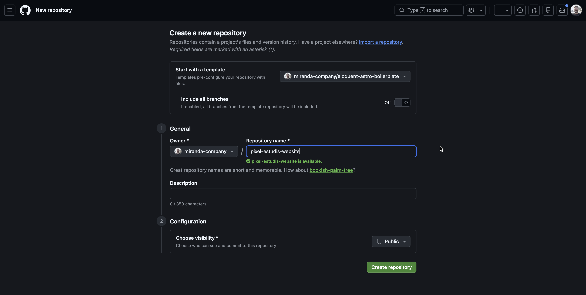

# Client project workflow

Use this workflow when turning the boilerplate into a client website. It keeps the starter stable, makes client-specific decisions explicit, and gives coding agents a clear, reviewable implementation boundary.

## Delivery flow

```text
Boilerplate repository
  → client repository
  → client configuration and design-system approval
  → content and reusable components
  → page implementation
  → integration, QA, and launch
```

Do not begin production-page implementation before stages 1 and 2 are complete. They establish the repository and visual language that every later page depends on.

## Stage 1 — Create and prepare the client repository

### 1. Create a separate repository

Create a new repository from `eloquent-astro-boilerplate`; do not develop a client site directly in the boilerplate repository. Keep the client repository private until the client approves its visibility.

In GitHub:

1. Open [`miranda-company/eloquent-astro-boilerplate`](https://github.com/miranda-company/eloquent-astro-boilerplate).
2. Select **Use this template**, then **Create a new repository**.
3. Select the approved GitHub owner (normally the agency organisation), enter the client repository name, and choose **Private**.
4. Select **Create repository**. Do not initialise it with a README, `.gitignore`, or licence: the boilerplate already supplies those files.
5. On the new repository page, select **Code**, copy the HTTPS clone URL, and use it in the commands below.

Keep **Include all branches** off so the client repository starts from the production-ready `main` branch only. Choose the agency organisation, use a clear client-specific repository name, and set visibility to **Private** before selecting **Create repository**.



### 2. Clone and run the untouched starter locally

1. In the agency projects folder, create a client workspace folder—for example, `Pixel Estudis`. Keep client-provided source material or internal working files outside the website repository.
2. Inside that workspace, create an empty folder for the website repository—for example, `pixel-estudis-website`. It must contain no files, folders, or hidden files before cloning.
3. Open that empty repository folder in VS Code: select **File → Open Folder…**, choose it, then select **Open**.
4. Open VS Code’s integrated terminal: select **Terminal → New Terminal**. It opens at the repository folder’s path; confirm the terminal prompt ends with the folder name.
5. On the new GitHub repository page, select **Code**, choose **HTTPS**, and copy the clone URL.

Run the following commands in that VS Code terminal, one line at a time, pressing `Return` after each. Paste the complete HTTPS URL copied from GitHub between `git clone` and the final `.`—do not add angle brackets. The final `.` means “clone into the folder that is already open”; do not omit it.

```sh
git clone https://github.com/miranda-company/example-client-website.git .
corepack enable
pnpm install --frozen-lockfile
pnpm run dev
```

The URL above is only an example. Use the exact URL copied from the client repository.

`git clone` downloads the repository into the folder open in VS Code. `corepack enable` makes the pinned pnpm version available, and `pnpm install --frozen-lockfile` installs exactly the dependency versions recorded in `pnpm-lock.yaml`.

The last command starts the local development server. Open the local URL it prints in the terminal (normally `http://localhost:4321`) and confirm the untouched boilerplate loads. Stop the server with `Ctrl+C` in that terminal. Do not use npm or introduce `package-lock.json`.

### 3. Preserve the baseline

Before changing code, confirm the duplicate is healthy:

```sh
pnpm run verify
pnpm run test:e2e
```

### 4. Mark the boilerplate baseline

Mark the exact starter state before client-specific work begins. Use an annotated Git tag so the team can compare a later client branch with the original boilerplate state.

If the new client repository was cloned from the boilerplate and already has its initial commit, verify that it is clean, then create and push a baseline tag:

```sh
git status
git log -1 --oneline
git tag -a boilerplate-baseline-v0.1.0 -m "Boilerplate baseline v0.1.0"
git push origin boilerplate-baseline-v0.1.0
```

Only create the tag when `git status` has no uncommitted changes. Replace `v0.1.0` with the boilerplate version used by the project if it differs. The tag is a fixed reference: do not move or reuse it after client work has started.

If the repository was created from a GitHub template and has no commit history, commit the untouched starter first, then tag it:

```sh
git add -A
git commit -m "chore: initialize from Eloquent Astro Boilerplate"
git tag -a boilerplate-baseline-v0.1.0 -m "Boilerplate baseline v0.1.0"
git push -u origin main
git push origin boilerplate-baseline-v0.1.0
```

Later, compare client work against this fixed point with:

```sh
git diff boilerplate-baseline-v0.1.0...HEAD
```

This gives the team a clean comparison point and makes future boilerplate upgrades easier to review.

### 5. Start agent work with explicit scope

Every coding-agent task should contain:

1. The requested outcome and the routes/components in scope.
2. Links or paths to the approved content and design source.
3. Relevant technical constraints: static output, approved integrations, responsiveness, supported locale(s), and performance budget.
4. Acceptance criteria: semantic HTML, metadata, accessibility, tests, and documentation updates when applicable.
5. Explicit exclusions, such as “do not add dependencies” or “do not change the token model.”

At the start of a task, instruct the agent to read `AGENTS.md`, `docs/DOM_ARCHITECTURE.md`, this guide, and any relevant focused guide. The agent should inspect existing patterns, state assumptions, and ask for a decision when a change would expand the agreed scope.

## Stage 2 — Configure the client and approve the design system

Treat this stage as a configuration milestone, not a page-building exercise. The current root route is a no-index design-system preview; keep it there until the client system is approved.

### 1. Configure site identity and SEO

Edit `src/config/client-config.ts` first.

1. Set `name` and the final canonical `url` using `https` and no path suffix.
2. Add the client email, optional phone number, social links, and initial Spanish navigation items.
3. Set the default title and description. Use accurate, client-approved wording rather than generic marketing claims.
4. Add `seo.defaultOgImage` only after a default social image is designed, exported, and available as a public site asset. Individual pages may later override it through `BaseLayout`.
5. Review feature flags. Keep `analytics`, `contactForm`, and `consentBanner` disabled until their provider and privacy requirements are approved. Confirm whether the default enabled `stickyHeader` and `backToTop` controls suit the approved design. Keep `wireframe` enabled only while reviewing layouts.
6. Configure `legal.pages` with the approved legal routes and labels. Keep its links aligned with the required legal content entries; the footer reads this configuration rather than maintaining a separate link list.

### 2. Replace brand assets

1. Put the approved logo and icon in `public/brand/` as final `.svg`, `.png`, `.jpg`, or `.jpeg` files. Prefer SVG when available; use transparent PNG for raster logos that need to work over varied backgrounds.
2. Update `brand.logo` and `brand.icon` if paths change.
3. Read each asset's intrinsic dimensions—its SVG `viewBox` for vectors or pixel dimensions for rasters—then set `logoWidth`, `logoHeight`, `iconWidth`, and `iconHeight` to matching positive values.
4. Run the site and confirm the header logo has a useful alternative name, renders at the intended aspect ratio, and is legible at compact widths.
5. Verify the design-system brand section displays each asset legibly on the backgrounds approved for that asset. Do not add an unapproved recolour or mask treatment.

### 3. Configure tokens from the approved design system

1. Treat the approved Figma variables as the source of truth for token names, values, and modes. Preserve the generic primitive names so client projects replace values without changing CSS references.
2. Replace `src/config/figma-tokens.json` with the approved Figma export. Keep the checked-in data aligned with the variable collections; do not hand-edit token values in `client-config.ts` or add code-only roles.
3. Keep site identity, URLs, contacts, and feature flags in `client-config.ts`; keep design-token values only in the Figma snapshot and emit their CSS properties through the token adapter.
4. Confirm the approved Google Font families and weights with the client. Keep families and normal weights in the Figma snapshot, verify each weight exists in Google Fonts, and retain the generic sans-serif fallback. Italics require a separate Figma token contract.
5. Use the internal preview to review primitive and semantic values and available color/spacing modes before page work begins.
6. If the design requires a token absent from the minimal Figma system, add and approve it in Figma first; update the snapshot and code together.
7. Keep breakpoint aliases in authored CSS, not token or site configuration. `src/styles/breakpoints.css` is the shared source; the wrapper uses `max-width-2xl` and `spacing-wrapper-default` while its responsive rule stays in `src/styles/global.css`.

### 4. Review the internal design system

Use the root preview to review the complete system with the designer/client:

- Brand logo and icon on the two monochrome surfaces
- Figma token inventory, values, semantic roles, and approved modes
- Typography, spacing, wrapper sizing/padding, radius, and breakpoint behavior
- Buttons, cards, forms, states, focus styles, and contrast
- Compact, medium, expanded, large, and extra-large layouts

Use `siteConfig.features.wireframe = true` only for temporary layout inspection during development. The root wireframe class is omitted from production builds. Once the design system is approved, set the flag to `false`, record any intentional exceptions in the relevant documentation, and commit the configuration milestone.

### 5. Configure approved integrations only

Copy `.env.example` to `.env` only for approved integrations. Leave unrelated values empty.

```sh
cp .env.example .env
```

Set public identifiers only:

- `PUBLIC_FORM_ENDPOINT` only when an approved client-specific form pattern has been added;
- `PUBLIC_GA_MEASUREMENT_ID` for Google Analytics; or
- `PUBLIC_GTM_CONTAINER_ID` for Google Tag Manager.

Enable both `analytics` and `consentBanner` only after their provider and privacy requirements are approved. Keep `contactForm` and `PUBLIC_FORM_ENDPOINT` disabled and empty until an approved client-specific form pattern is added. Keep unrelated flags `false` and their environment values empty.

Never put secrets in a `PUBLIC_` variable. Read [integrations and privacy](integrations.md) before enabling a provider. A future form pattern requires approval of its provider, privacy treatment, and usable non-JavaScript submission path; ensure legal/cookie copy describes the services actually used.

### 6. Configure legal-page structure

The three Spanish legal entries use `template: legal`. Before page implementation begins:

1. Keep each `legal.navigation` item aligned with one stable MDX `<section id="…">`.
2. Use the optional notice only while text is awaiting approval; remove it after legal sign-off.
3. Add summary facts and an update date only when they are verified.
4. Confirm that the configured footer routes, page descriptions, actual providers, and approved legal copy agree.

Read [content authoring](content.md) for the legal frontmatter and semantic MDX pattern.

### Stage 2 exit criteria

Move to content and page work only when:

- [ ] The canonical URL, contacts, navigation, and default metadata are configured.
- [ ] Brand assets and intrinsic dimensions are configured and visually verified.
- [ ] The token system is approved in the internal preview.
- [ ] Wireframe mode is off except during an active review.
- [ ] Legal routes, footer labels, legal navigation IDs, and approved-copy status are aligned.
- [ ] Approved integrations are configured; unapproved integrations remain disabled and empty.
- [ ] `pnpm run verify` and `pnpm run test:e2e` pass.

## Stage 3 — Model content and build reusable components

Define or extend Content Collection schemas before adding new frontmatter fields. Build reusable, semantic components before composing repeated page patterns. Keep client configuration out of Markdown/MDX frontmatter.

Follow [content authoring](content.md), the relevant pattern document under `docs/component-library/`, and [semantic DOM architecture](DOM_ARCHITECTURE.md). Compose approved Astro patterns from MDX using their typed content props. Keep each pattern's Figma frame, implementation, token usage, and verification expectations current in its own document. For every public route, use `BaseLayout`, one `h1`, sequential headings, accurate metadata, and JSON-LD only when it truthfully represents visible indexable content.

## Stage 4 — Build pages in vertical slices

Implement one purposeful slice at a time:

```text
approved content → component → section → route → metadata/schema → responsive and accessibility checks
```

Do not add a library to solve a one-off visual task. Prefer the existing token system and component patterns. Update tests when a shared component, interaction, route, metadata behavior, or semantic structure changes.

## Stage 5 — Prepare for launch

1. Move the approved design-system preview from `/` to `/design-system`; retain `noindex`.
2. Replace `/` with the public homepage and set `siteConfig.features.designSystemHomepage` to `false` so the homepage enters the sitemap.
3. Replace all sample content and legal placeholders with client-approved copy.
4. Verify canonical URLs, metadata, social images, robots, sitemap, consent behavior, and production analytics behavior. Verify any future form against its approved submission and fallback contract.
5. Test integrations in both states:
   - with features disabled, confirm there is no consent banner/control, analytics loader, or third-party request;
   - with each approved feature enabled, confirm the consent flow, provider requests, and legal disclosures match the approved brief; test any future form against its approved fallback contract.
6. Run the complete verification suite:

```sh
pnpm run verify
pnpm run test:e2e
```

7. Review the production build locally with `pnpm run preview`, then deploy through the approved hosting workflow.

## Ongoing maintenance

Keep the client repository's README and relevant guides current when architecture or integrations change. Use small, descriptive commits and review agent changes as you would a teammate's work: inspect the diff, run the relevant checks, and confirm that the change meets the approved scope.

During routine maintenance and before release, run `pnpm audit --prod` when network access is available. Review dependency updates and applicable audit findings manually; the starter does not automate either process.
